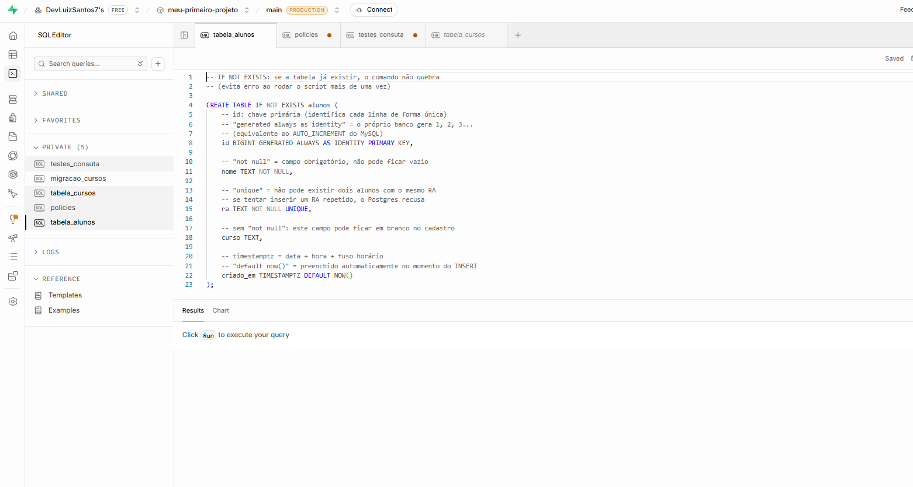
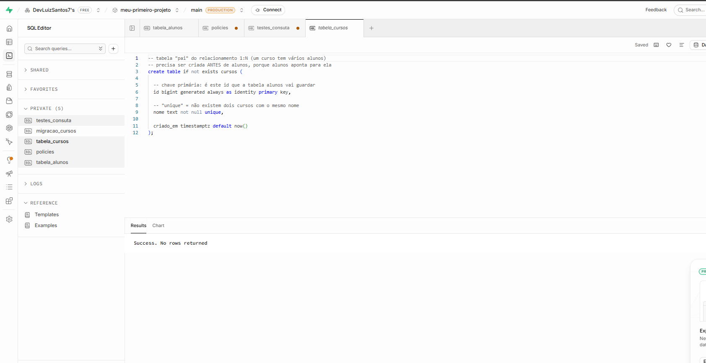
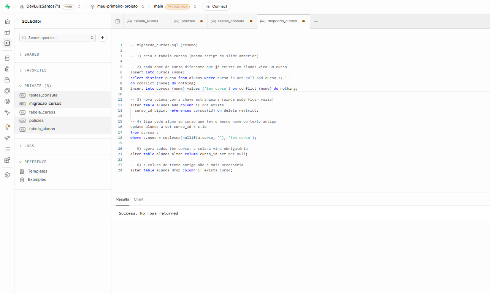
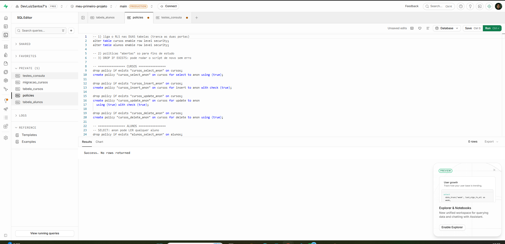
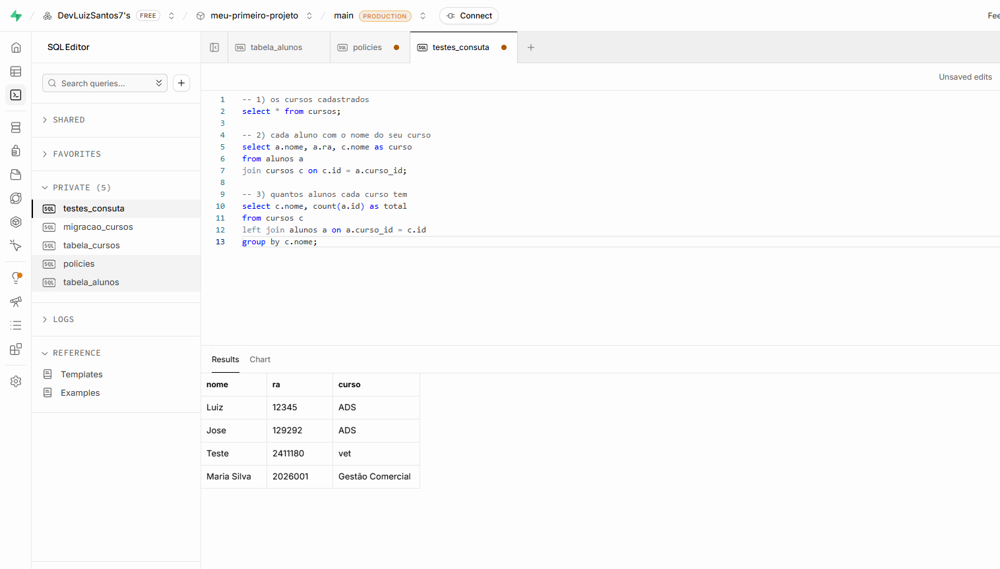

# CRUD de Alunos

Aplicação didática em Node.js para estudar uma API REST com Express e persistência no Supabase. O projeto modela alunos e cursos em uma relação de um para muitos: cada aluno pertence a um curso, e um curso pode estar associado a vários alunos.

## Tecnologias

- Node.js e Express
- Supabase (PostgreSQL e `@supabase/supabase-js`)
- HTML, CSS e JavaScript no frontend
- `dotenv` para carregar configurações locais

### Tabela inicial de alunos

### Tabela de cursos

### Migração para a relação aluno–curso

### Políticas de acesso e RLS

### Consultas de validação

A imagem registra consultas para listar cursos, listar alunos com seus cursos e contar alunos por curso.

